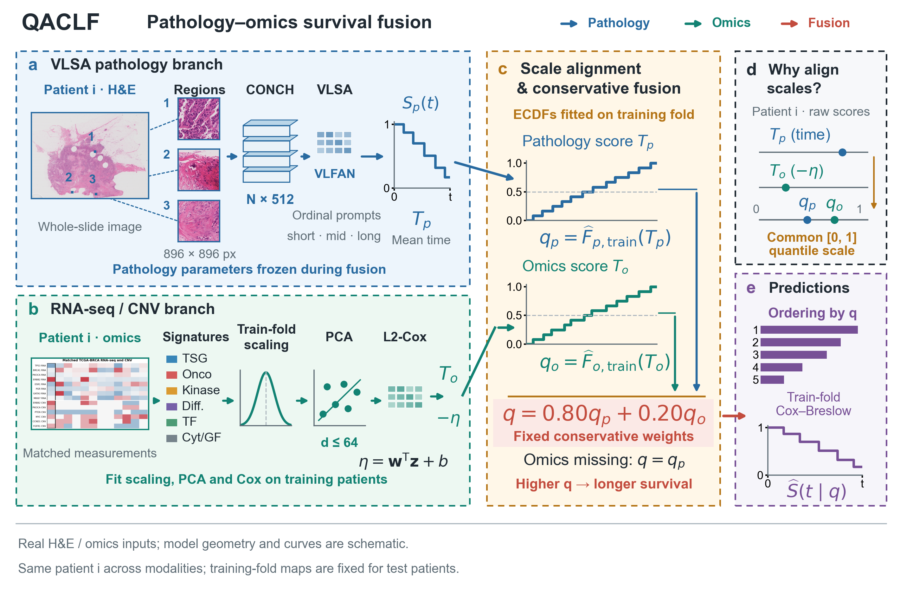

# QACLF

**Quantile-Aligned Conservative Late Fusion**, formerly named FICPF, is a
pathology-omics survival prediction framework. It reuses a frozen VLSA pathology
predictor with CONCH patch features, fits a training-fold RNA-seq/CNV PCA-Cox
branch, aligns both scores using training-fold ECDF percentiles, and combines
them with fixed pathology/omics weights of 0.80/0.20. Missing omics falls back to
the pathology percentile. Survival curves use a training-fold Cox-Breslow mapping.
Score alignment is not itself survival-probability calibration.



The repository URL remains `https://github.com/carbered/FICPF` to preserve links.
Historical `ficpf` filenames and raw result identifiers remain unchanged for
reproducibility; they refer to the same method, not a different model.
The current Chinese Word manuscript is private and is not included.

## Current Results

Five TCGA cohorts (BLCA, BRCA, GBMLGG, LUAD and UCEC) share fixed patient-level
outer five-fold splits. All eight models use precomputed CONCH pathology inputs.
Means are calculated per fold, then per cohort, then equally across cohorts.

| Method | Macro C-index | Macro IBS, 12-60 months |
|---|---:|---:|
| ABMIL | 0.6215 | 0.1670 |
| TransMIL | 0.6447 | 0.1839 |
| ILRA | 0.6364 | 0.2061 |
| DSMIL | 0.6591 | 0.1698 |
| VLSA | 0.6958 | 0.1797 |
| MCAT | 0.6793 | 0.1641 |
| CAT-with-TPL | 0.6697 | 0.1659 |
| QACLF | 0.7050 | 0.1545 |
| VLSA + same curve mapping (control) | 0.6959 | 0.1572 |

The mapping control is not a ninth model architecture. Much of the IBS improvement
over native VLSA comes from curve reconstruction and cannot all be attributed to
omics fusion. QACLF's locked seed-42 macro C-index remains 0.7050168898 versus
0.6957818080 for VLSA; the paired gain is 0.0092350817 (bootstrap 95% CI
0.0016-0.0169). Additional pathology seeds 3404 and 3405 assess stability; they
do not replace the main result.

- [Current cohort C-index means and population SDs](result/qaclf-nested-v1-unified-evaluation-20261027/updated_eight_method_dataset_summary.csv)
- [Current macro probability metrics](result/qaclf-nested-v1-unified-evaluation-20261027/macro_metrics.csv)
- [All 225 fold evaluations](result/qaclf-nested-v1-unified-evaluation-20261027/all_fold_metrics.csv)
- [Current ranking figure](figures/qaclf_current/QACLF_eight_method_comparison.pdf)
- [Current probability figure](figures/qaclf_current/QACLF_unified_probability.pdf)
- [Ablation and sensitivity](figures/qaclf_current/QACLF_ablation_sensitivity.pdf)
- [Omics robustness](figures/qaclf_current/QACLF_omics_robustness.pdf)
- [OOF risk stratification](figures/qaclf_current/QACLF_oof_km_risk_stratification.pdf)

## Protocol and Interpretation

MCAT and CAT-with-TPL use the completed 50-run `qaclf-multimodal-nested-v1`
rerun: fitting-patient-only preprocessing and four time bins, inner-validation
NLL epoch selection (up to 20 epochs), fresh outer-training refitting for the
selected epoch count, and one outer-test evaluation. Pathology-only baselines
retain their VLSA/SA training configurations, rather than sharing all optimizer
settings with multimodal models.

Current probability evaluation uses 97 fixed points over 12-60 months, linear
interpolation and censoring weights estimated only on outer-training patients.
D-calibration uses 10 bins and administrative censoring at 60 months. Counts of
folds with p >= 0.05 are descriptive, not proof of calibration or a pooled test.
Unrestricted mean-time hinge MAE is diagnostic only; no tail-repair claim is made.

The comparator rerun, mapping control and revised evaluation window are post-hoc
and reuse earlier outer splits. This is not an independent untouched test.
All cohorts are from TCGA; independent external validation remains necessary.
The older MCAT/CAT adaptations, old-window metrics and `docs/FICPF*` drafts remain
historical records. Do not mix their numbers with the current tables or treat
them as the current manuscript. Historical inputs/results are not relabelled or
overwritten merely to hide discrepancies.

## Data and Resources

The included analysis covers 2,831 patients, 3,529 available slides and 15,615,143
patches. See [dataset statistics](result/ficpf-dataset-resource-audit/dataset_statistics.csv).
The representative BLCA fold-0 benchmark uses 6,956 patches, cached text features,
RTX 5070 Ti Laptop GPU and single-thread i9-14900HX CPU processing. Median
feature-to-curve-and-mean-time latency is 25.61 ms for VLSA and 62.17 ms for QACLF
(100 repeats). It excludes WSI encoding, disk I/O and input transfer, is not a
cohort-average measurement, and does not imply faster QACLF inference.
QACLF adds 65 Cox coefficients; fitted preprocessing/mapping state is separate.

Raw WSIs, CONCH weights, patch features, model checkpoints and large preprocessed
omics tables are excluded. Fixed splits, survival labels, retained predictions,
small real TCGA schematic assets and integrity metadata are included.
See [DATA.md](DATA.md) for input boundaries and [NOTICE.md](NOTICE.md) for sources.

## Installation and Verification

Python 3.10+ is recommended for the analysis package. The cloud training runtime
under `protocol/qaclf_nested_v1/` separately preserves its Python 3.8 environment.

```bash
python -m pip install -r requirements.txt
python tools/verify_qaclf_release.py
```

The default verifier checks the complete file manifest, package scope, frozen
primary and multi-seed results, current aggregation, exact nested runtime hashes,
selection records and all 225 compact curve-input hashes. It does not train.

```bash
python tools/verify_qaclf_results.py --recompute-c-index --recompute-probability
```

This additionally recomputes 100 retained MIL C-indices, all 225 current
probability evaluations and 50 nested native-risk C-indices without the omitted
weights/features/omics tables. It uses the same fixed-window metric function as
the retained cloud runtime. Historical-only verification remains available as
`tools/verify_historical_results.py`; original `ficpf` entry points are retained.

## Figure Regeneration

```bash
python tools/plot_ficpf_six_method_comparison.py --include-dsmil --canonical-names --model-label QACLF --nested-rerun --data-summary result/qaclf-nested-v1-unified-evaluation-20261027/updated_eight_method_dataset_summary.csv --output-stem figures/reproduced_eight_method_comparison
python tools/refine_ficpf_main_figure.py --tinted --canonical-names --model-label QACLF --output-stem figures/reproduced_method
python tools/plot_qaclf_unified_probability.py
```

The optional local layout-audit helper is not required for plotting. The last
command writes to `figures/qaclf_nested_v1_20261027/`, not the frozen current
figure directory. Complete training still requires upstream code and excluded
inputs. See [protocol notes](docs/CURRENT_RESULTS.md) and the preserved cloud
README; the public snapshot does not claim checkpoint-level retraining validation.

The manuscript citation will be added after publication. Historical references
are in `docs/references.bib`. See [LICENSE](LICENSE). A [Chinese quick-start](README_中文.md)
is available. No partial MOTCat experiment is included as a complete comparator.
